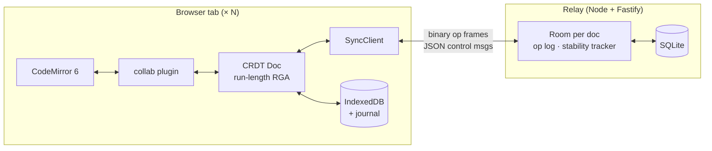

# CollabPad

A Google-Docs-style notepad. Several people can edit the same document at once, keep typing
offline, and see every copy converge to the same text. It runs on a **sequence CRDT written from
scratch**: no Yjs, no Automerge, no operational transformation server.


## Highlights

- **RGA sequence CRDT from first principles.** Unique `(replica, seq)` ids, Lamport-ordered
  tie-breaks, deletion tombstones, causal buffering and idempotent delivery.
  [`packages/crdt`](packages/crdt)
- **Proven convergence.** A deterministic network simulator shuffles, delays, duplicates and drops
  messages and takes replicas offline. 10,000 random runs end with identical SHA-256 state hashes.
  Deliberately breaking the CRDT makes the suite fail within a few runs.
- **Offline-first.** Edits survive reloads (IndexedDB, plus a synchronous journal written while the
  page closes). Reconnecting exchanges version vectors and sends only the missing ops: **110 bytes**
  after 10 offline edits, versus a 629 KB snapshot.
- **Safe tombstone garbage collection.** A two-round stability protocol plus an RGA "old
  neighbour" rule. The obvious rule ("everyone has seen the delete") turned out to be unsafe;
  [`docs/TOMBSTONES.md`](docs/TOMBSTONES.md) shows the counterexample and the fix.
- **Fast.** Replays the 259,778-edit [automerge-paper trace](https://github.com/josephg/editing-traces)
  in **1.44 s** (p50 1.2 µs per edit). Live ops cost **24 bytes** on the wire, and a replica holds
  **1.3 MB** after GC. [`docs/REPORT.md`](docs/REPORT.md)
- **Real product surface.** Live cursors with names, presence avatars, share links, a status badge
  ("Offline · 3 changes pending"), dark mode, and an **Internals** panel. The panel shows version
  vectors, tombstones, bytes on the wire, the op stream, a "simulate offline" switch and a
  concurrency lab.

## How it works



1. **Typing.** A keystroke becomes a CRDT op: insert char `c` after element `X`, with id `(replica, seq)`
   and a Lamport stamp. It is applied locally at once and sent to the relay as a compact binary frame.
2. **The relay.** It persists the op to SQLite, then forwards it. It never transforms or rejects
   edits for being concurrent. Writes are keyed by `(doc, replica, seq)`, so the relay is
   idempotent.
3. **Remote ops.** They can arrive late, twice or out of order. A replica applies each one only
   when it is causally ready, and parks it until then. Concurrent inserts at the same spot are
   ordered by stamp, so every replica builds the same sequence.
4. **Reconnecting.** A client sends `hello{versionVector}`. The relay replies with exactly the
   missing ops plus its own vector, and the client sends back what the relay lacks.
5. **Cleaning up.** Deleted characters stay as tombstones until the relay's two-round stability
   protocol says they can go. New clients load a compact collected snapshot instead of the full
   history.

## Testing

| Layer             | What it checks                                                                      |
| ----------------- | ----------------------------------------------------------------------------------- |
| Unit + scenario   | Concurrent insert/insert and insert/delete at the same position, anchors, snapshots |
| Differential      | Run-length RGA equals the per-character reference, element for element              |
| Property / fuzz   | 10k simulated runs (reorder, duplicate, drop, partition, GC) vs. a no-GC oracle     |
| Adversarial GC    | Collect before late ops arrive; the neighbour-rule trap as a fixed example          |
| Codec             | Binary round-trips; the untrusted decoder survives 5k random and mutated inputs     |
| Relay integration | 3 real WebSocket clients, offline merge, relay restart, eviction and rejoin, abuse  |
| E2E (Playwright)  | 3 browsers, offline + reload, two tabs, GC, against dev **and** the Docker image    |

Every safety rule was checked by mutation: remove it, and the suite fails. 322 unit and
integration tests plus 6 browser tests run in CI, with 99% line coverage and a nightly
10,000-run fuzz.

## Run it

```bash
corepack enable && pnpm install
pnpm dev                 # relay on :8787 + web app on http://localhost:5173
pnpm test                # unit, integration, 300-run fuzz
pnpm e2e                 # Playwright (PW_CHANNEL=chrome to use a local Chrome)
pnpm fuzz                # 10,000-run convergence fuzz
pnpm demo:3clients       # three headless clients, one offline, all converge
pnpm bench:fetch && pnpm bench && pnpm bench:charts
```

**Docker** (one container serves the app and the relay):

```bash
docker compose up --build    # http://localhost:8787, data in a named volume
```

**Deploy:** [`fly.toml`](fly.toml) (Fly.io, with a persistent volume) or [`render.yaml`](render.yaml)
(Render blueprint). Run a single instance: rooms live in memory and SQLite is a local file.

Relay settings come from environment variables: `PORT`, `DB_PATH`, `WEB_DIST`, `CORS_ORIGIN`,
`MAX_MESSAGE_BYTES`, `RATE_LIMIT_PER_SECOND`, `RATE_LIMIT_BURST`, `REPLICA_LEASE_MS`, `LOG_LEVEL`.

## Repository layout

| Path                                     | What                                                                              |
| ---------------------------------------- | --------------------------------------------------------------------------------- |
| [`packages/crdt`](packages/crdt)         | RGA, version vectors, causal delivery, GC, stability tracker, rebase              |
| [`packages/protocol`](packages/protocol) | Message types, zod validation (server-only entry), binary op codec                |
| [`packages/client`](packages/client)     | `SyncClient`: handshake, reconnect with backoff, acks, presence, rejoin           |
| [`packages/sim`](packages/sim)           | Deterministic network simulator and convergence fuzzer                            |
| [`apps/relay`](apps/relay)               | Fastify + WebSocket relay, SQLite persistence, REST, static web app               |
| [`apps/web`](apps/web)                   | React + CodeMirror editor, offline storage, Internals panel                       |
| [`bench`](bench)                         | Benchmarks on the automerge-paper trace, chart generation                         |
| [`e2e`](e2e)                             | Playwright tests                                                                  |
| [`docs`](docs)                           | [Tombstone GC argument](docs/TOMBSTONES.md), [performance report](docs/REPORT.md) |
| [`PRD`](PRD)                             | Original brief, requirements analysis, implementation plan                        |

## Design decisions

- **CRDT, not OT.** There is no central transform step, so offline editing is natural and the
  relay stays a simple, idempotent mailbox.
- **Separate delivery id and ordering stamp.** Contiguous per-replica seqs make version vectors a
  complete summary for anti-entropy. Lamport stamps give RGA its total order.
- **Correctness never depends on the network.** Ops can arrive in any order, any number of times;
  the causal buffer handles it. The simulator deliberately reorders what WebSockets would not.
- **Tombstones are kept until provably unneeded.** Safety is argued on paper, pinned by tests and
  checked by mutation. Liveness comes from membership leases, with a rebase path for replicas that
  return after eviction.
- **Run-length items.** Runs make the RGA 7× faster on the full trace and shrink metadata. A
  differential test keeps them identical to the simple version.

## Limits

Plain text only (no rich text). One relay instance. A client that loses state the relay already
acknowledged would reuse sequence numbers, which the relay does not yet detect. The relay keeps a
document's op log in memory. See [`docs/REPORT.md`](docs/REPORT.md#limits-and-next-steps).
