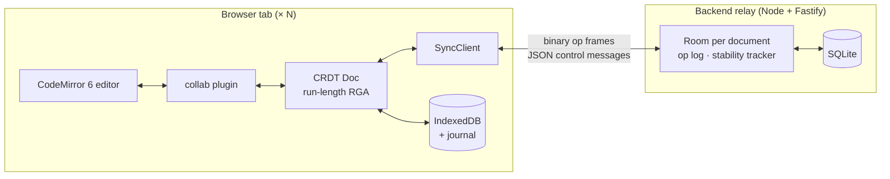

# CollabPad: project summary

A real-time collaborative text editor, in the style of Google Docs, built on a **sequence CRDT
written from scratch** (no Yjs, no Automerge, no operational-transformation server). Several people
can edit the same document at once, keep typing while offline, and every copy converges to the
same text.

- **Type:** Solo project, full stack and distributed systems
- **Timeline:** October 2026
- **Repository:** <https://github.com/ViserionBuild/RTC_TextEditor>
- **Live demo:** _add the Render URL after deploying_
- **Size:** about 4,500 lines of TypeScript source and 2,300 lines of tests

---

## 1. Resume entry (copy-paste)

**CollabPad: real-time collaborative editor on a from-scratch CRDT** |
_TypeScript, React, CodeMirror 6, Node.js, Fastify, WebSockets, SQLite, IndexedDB, Vitest,
Playwright, GitHub Actions_

- Built a Google-Docs-style collaborative editor on a **from-scratch RGA sequence CRDT** (no
  Yjs/Automerge), with live cursors, presence, and **offline editing that survives page reloads**
  and merges conflict-free across any number of clients.
- Designed a **version-vector sync protocol** with a **binary wire format**: **24 B per keystroke**
  (7× smaller than JSON) and **110 B to resync after 10 offline edits**, versus a 629 KB full
  snapshot.
- Verified **strong eventual consistency** with a deterministic network simulator: **10,000
  randomized runs** with reordered, duplicated and dropped messages and network partitions, with
  0 divergences. Each safety rule was confirmed by mutation testing.
- Showed that the textbook tombstone garbage-collection rule is **unsafe for RGA**, built the
  counterexample, and designed a **two-round causal-stability protocol** that cut snapshots by
  **58%** and per-replica memory from **51.6 MB to 1.3 MB**.
- Re-engineered the CRDT with **run-length items and a chunked index**: it replays the
  **259,778-edit automerge-paper trace in 1.44 s** (p50 1.2 µs per edit), **7× faster** than
  the first version.

### Shorter variants

**Two lines:**

> Built a real-time collaborative editor (TypeScript, React, WebSockets, SQLite) on a
> from-scratch CRDT with offline editing, a binary sync protocol (24 B/keystroke) and safe
> tombstone GC (−97% memory), verified by 10,000 randomized network-fault simulations.

**One line:**

> Real-time collaborative text editor on a from-scratch CRDT, with offline sync and provably safe
> garbage collection.

---

## 2. The problem

When several people edit the same text at the same time, their edits conflict. If Alice types at
position 5 while Bob deletes position 3, then applying both edits naively gives each user a
different document. There are two standard approaches:

| Approach                                      | How it works                                                                | Weakness                                                     |
| --------------------------------------------- | --------------------------------------------------------------------------- | ------------------------------------------------------------ |
| **Operational Transformation** (old Docs)     | A central server rewrites every edit against the edits it raced             | Needs the server in the loop, so offline editing is hard     |
| **CRDT** (Conflict-free Replicated Data Type) | Edits are designed so that applying them in any order gives the same result | Deleted text has to be kept as "tombstones", so memory grows |

CollabPad uses a CRDT. Most projects import a library such as Yjs for this. This project
implements the whole algorithm, the sync protocol and the garbage collection from first
principles, then measures and tests them like a production system.

---

## 3. Features

**For users**

- Live collaborative editing with **named cursors** and **presence avatars**
- **Offline editing**: keep typing with no network; edits are stored in the browser and merge on
  reconnect
- Edits **survive reloads and crashes** (IndexedDB plus a synchronous journal written while the
  page closes)
- Share links, document titles, a list of recent documents, dark mode
- Status badge, for example `Offline · 3 changes pending`

**For engineers (the "Internals" panel)**

- Live view of version vectors, tombstone count, bytes sent and received, and the op stream
- A **"Simulate offline"** switch
- A **Concurrency lab** that replays the classic conflict cases step by step
- A **state hash**: two windows showing the same hash have identical documents

---

## 4. Architecture

| Folder            | Role                                                                    |
| ----------------- | ----------------------------------------------------------------------- |
| `frontend/`       | React + CodeMirror 6 editor, offline storage, Internals panel           |
| `backend/`        | Fastify + WebSocket relay, SQLite persistence, REST API, serves the app |
| `shared/crdt`     | The CRDT: RGA sequence, version vectors, causal delivery, GC, rebase    |
| `shared/protocol` | Message types, input validation (zod), binary op codec                  |
| `shared/client`   | `SyncClient`: handshake, reconnect with backoff, acks, presence         |
| `shared/sim`      | Deterministic network simulator and convergence fuzzer                  |

### How an edit travels

1. **Typing.** A keystroke becomes a CRDT operation: "insert `c` after element `X`", with a
   unique id `(replica, seq)` and a Lamport timestamp. It is applied locally at once (no waiting
   for the server) and sent to the relay as a compact binary frame.
2. **The relay** saves the op to SQLite, then forwards it to everyone else in the room. It never
   transforms or rejects edits. Writes are keyed by `(doc, replica, seq)`, so a duplicate is
   harmless.
3. **Other clients** may receive ops late, twice or out of order. Each op is applied only once
   everything it depends on has arrived, and is parked until then. Concurrent inserts at the same
   spot are ordered by timestamp, so every client builds the same sequence.
4. **Reconnecting** after being offline: the client sends its version vector ("I have ops 1–40
   from Alice, 1–12 from Bob"). The relay replies with exactly the missing ops, and the client
   sends back what the relay is missing.
5. **Cleaning up.** Deleted characters stay as tombstones until the relay's stability protocol
   proves that no one can still refer to them. New clients then load a compact snapshot instead of
   the full history.

### Key design decisions

- **CRDT, not OT.** There is no central transform step, so offline editing comes naturally and
  the server stays a simple, idempotent mailbox.
- **Separate delivery id and ordering stamp.** Per-replica sequence numbers make version vectors
  a complete summary for sync; Lamport stamps give the total order.
- **Correctness never depends on the network.** The simulator deliberately reorders and drops
  messages, which real WebSockets would not, so the algorithm cannot rely on ordering.
- **Binary for ops, JSON for control.** The hot path is compact; the rare messages stay easy to
  debug.
- **One process in production.** The relay also serves the built frontend, so deployment is a
  single Node service with no Docker.

---

## 5. Results

Measured on the standard [automerge-paper editing trace](https://github.com/josephg/editing-traces)
(259,778 keystrokes recorded while writing a real academic paper) on a 2017 laptop CPU. Full
report: [REPORT.md](REPORT.md).

| Metric                                  | Result                                     |
| --------------------------------------- | ------------------------------------------ |
| Replay the whole trace                  | **1.44 s** (about 180,000 ops/s)           |
| Latency per edit                        | p50 **1.2 µs**, p99 **42 µs**              |
| Run-length vs first (per-character) RGA | **1.3 s vs 9.5 s** (7× faster)             |
| Bytes per live keystroke                | **24 B** binary vs 168 B JSON (7× smaller) |
| Full history on the wire                | **0.35 MB** vs 36.3 MB JSON (105× smaller) |
| Reconnect after 10 offline edits        | **110 B** vs a 629 KB full snapshot        |
| Snapshot after garbage collection       | **262 KB**, down from 629 KB (−58%)        |
| Memory per replica after GC             | **1.3 MB**, down from 51.6 MB (−97%)       |

---

## 6. Testing and quality

| Layer             | What it checks                                                                       |
| ----------------- | ------------------------------------------------------------------------------------ |
| Unit and scenario | Concurrent insert/insert and insert/delete at the same position, snapshots           |
| Differential      | The optimized run-length RGA equals the simple per-character one, element by element |
| Property / fuzz   | 10,000 simulated runs (reorder, duplicate, drop, partition, GC) vs. a no-GC oracle   |
| Adversarial GC    | Collecting before late ops arrive; the counterexample kept as a fixed test           |
| Codec security    | The binary decoder handles untrusted input: 5,000 random and corrupted frames        |
| Relay integration | Three real WebSocket clients, offline merge, server restart, eviction, abuse         |
| End to end        | Playwright drives real browsers: offline + reload, two tabs, GC                      |

- **324** unit and integration tests and **6** browser tests, **99%** line coverage
- **Mutation-checked:** removing any safety rule makes the suite fail
- **CI (GitHub Actions):** lint, format, typecheck, tests with coverage, and browser tests against
  the production build on every push; a **nightly 10,000-run fuzz** job

---

## 7. Hard problems solved (interview stories)

### 1. The textbook garbage-collection rule is wrong

**Situation.** Tombstones grew to 42% of the document. The usual rule says: delete a tombstone
once every replica has seen the delete.

**Problem.** In RGA, an insert finds its place by scanning right and stopping at the first
_older_ element. Tombstones are stopping points too. Removing one can make a later concurrent
insert land somewhere else, so two replicas show `ONY` and `OYN` forever.

**Action.** I built the exact schedule that triggers the bug and wrote the argument down. Then I
added an "old right neighbour" condition and a second round of stability checking, and confirmed
each rule by deleting it and watching tests fail. Random fuzzing never found this bug, because
FIFO WebSockets through one relay cannot produce that schedule. So I kept it as a fixed test and
documented why. ([TOMBSTONES.md](TOMBSTONES.md))

**Result.** Safe GC: snapshots −58%, memory 51.6 MB → 1.3 MB.

### 2. The benchmark found two production bugs

- `ops.push(...ops)` on 260,000 ops **overflowed the call stack**.
- Catching up on 200,000 ops took **512 seconds**, because parked ops were rescanned every time a
  new op arrived (quadratic). I replaced the rescan with a **dependency-indexed wait queue**, and
  it now takes milliseconds.

### 3. Offline edits sometimes vanished on reload

**Action.** I instrumented the run instead of guessing. The reloaded page claimed a new replica
id before the old page had released its Web Lock, so unsent edits were stored under the old id
and never resent.

**Fix.** Remember the tab's replica id in `sessionStorage`, wait for its lock, and write a
synchronous journal on `pagehide`.

### 4. A 7× speed-up without risking correctness

The first RGA stored one array slot per character: an O(n) scan and splice on every insert. I
switched to **runs** (one item per stretch of consecutive typing) stored in blocks of about 128
with cached counts, so position lookups cost about O(√n). Lamport stamps rise along a run, so the
integration scan can decide a whole run from its first character. A **differential test** feeds
random concurrent streams to both versions and requires identical results.

### 5. Testing a distributed system without flaky tests

- A **seeded, deterministic simulator**: every failure replays exactly and shrinks to a minimal
  case.
- A **differential oracle** for the optimized data structure.
- **End-to-end tests** that run in CI against the real production build.

---

## 8. Likely interview questions

**Why a CRDT instead of OT?**
OT needs a central server to transform concurrent edits, which makes offline editing hard. With
a CRDT, operations commute, so any client can apply them in any order and still converge. The
server only stores and forwards.

**What is a version vector?**
A map from each replica to the number of its ops you have seen, for example
`{alice: 40, bob: 12}`. Comparing two vectors shows exactly which ops each side is missing, so
reconnecting sends only the difference.

**Why keep tombstones at all?**
Other replicas may still send inserts that say "after character X". If X were gone, they could
not be placed. Tombstones can only be removed once it is proven that nothing can refer to them.

**How do you know it converges?**
Three kinds of evidence: a written argument for the GC rules, 10,000 randomized simulations with
adversarial networks compared against a reference implementation, and mutation testing showing
that each safety rule is actually needed.

**What are the limits?**
Plain text only, one relay instance, and the relay keeps each document's op log in memory. Next
steps would be serving old ops from SQLite, binary snapshots, and a B-tree index for O(log n)
lookups.

---

## 9. Skills demonstrated

- **Distributed systems:** CRDTs, causal delivery, version vectors, Lamport clocks, anti-entropy,
  idempotency, causal stability
- **Algorithms and data structures:** RGA, run-length encoding, chunked indexes, varint encoding
- **Backend:** Node.js, Fastify, WebSockets, SQLite, REST, rate limiting, input validation
- **Frontend:** React, CodeMirror 6, IndexedDB, Web Locks, offline-first design
- **Testing:** property-based testing (fast-check), fuzzing, differential and mutation testing,
  Playwright end-to-end tests
- **Performance engineering:** benchmarking on real traces, profiling, 7× optimization
- **DevOps:** pnpm monorepo, GitHub Actions CI, nightly fuzzing, deployment on Render

**ATS keywords:** TypeScript, JavaScript, React, Node.js, WebSocket, real-time, CRDT, distributed
systems, offline-first, SQLite, IndexedDB, Fastify, Vitest, Playwright, CI/CD, GitHub Actions,
performance optimization, binary protocol
