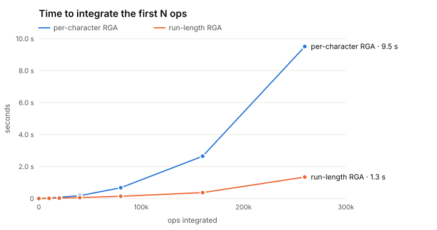
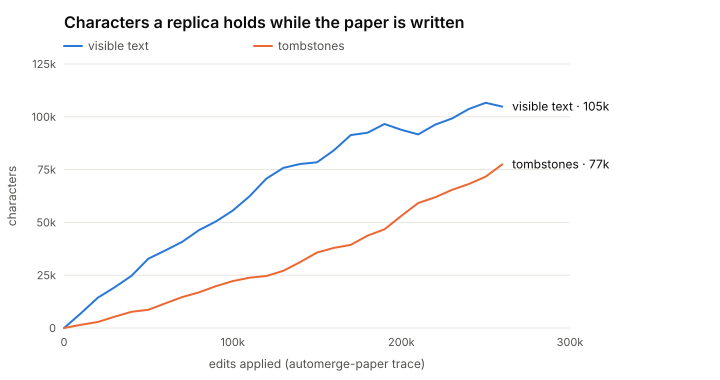

# CollabPad performance and metadata report

This report covers metrics M-1 to M-5 from the [requirements](../PRD/01-requirements-analysis.md):
bytes on the wire, reconnect cost, metadata growth, tombstones and speed. Every number comes from
one run of `pnpm bench`, and the raw output is written to `bench/results/results.json`.

**Setup:** Node v26.5.0, Linux x64, Intel Core i5-8250U (a 2017 laptop CPU, 1.6 GHz base).

**Workload:** the [automerge-paper editing trace](https://github.com/josephg/editing-traces).
These are the 259,778 single-character keystrokes (182,315 inserts, 77,463 deletes) recorded while
writing a 104,852-character LaTeX paper. It is the standard benchmark for text CRDTs, so the
numbers can be compared with other implementations.

## Summary

| Metric                                       | Result                                            |
| -------------------------------------------- | ------------------------------------------------- |
| Replay the whole trace (local edits)         | **1.44 s**, about 180,000 ops/s                   |
| Per-edit latency                             | p50 **1.2 µs**, p99 **42 µs**                     |
| Integrate the whole trace as remote ops      | 1.32 s in one batch, 1.54 s one op at a time      |
| Run-length vs per-character RGA (full trace) | **1.3 s vs 9.5 s**, and the gap grows with size   |
| Bytes per live keystroke                     | **24 B** binary vs 168 B JSON (7× smaller)        |
| Full history on the wire                     | **0.35 MB** binary vs 36.3 MB JSON (105× smaller) |
| Reconnect after 10 offline edits             | **110 B** vs a 629 KB full snapshot               |
| Snapshot after tombstone GC                  | **262 KB**, down from 629 KB (−58%)               |
| Memory for one replica after GC              | **1.3 MB** (51.6 MB while the op log is kept)     |

## M-5: speed

<picture>
  <source media="(prefers-color-scheme: dark)" srcset="charts/integration-dark.svg">
  
</picture>

| Ops integrated | Per-character RGA | Run-length RGA | Speed-up |
| -------------: | ----------------: | -------------: | -------: |
|         10,000 |             24 ms |          13 ms |     1.8× |
|         40,000 |            179 ms |          60 ms |     3.0× |
|         80,000 |            675 ms |         139 ms |     4.9× |
|        160,000 |          2,648 ms |         370 ms |     7.2× |
|        259,778 |          9,512 ms |       1,344 ms |     7.1× |

- **Why the first version was slow.** It stored one array slot per character, so every insert did
  an O(n) scan and an O(n) splice, and total time grew quadratically.
- **What changed.** The current RGA stores **runs**: one item per stretch of characters a replica
  typed consecutively. Items live in blocks of about 128, and each block caches its
  visible-character count. A position lookup skips whole blocks, then whole runs, so it costs
  about O(√n) instead of O(n).
- **Why runs are safe for RGA.** Lamport stamps rise along a run, so the integration scan can skip
  a run, or stop at it, by looking only at the run's first character.
- **How it was verified.** A differential test feeds random concurrent op streams, delivered in
  shuffled order, to both implementations and requires the exact same element sequence,
  tombstones included. That test has passed thousands of runs.

The per-character column times only the bare sequence structure. The run-length column also
includes the full `Doc` layer: causal buffering, version vectors and the op log. The comparison
therefore favours the old version.

## M-1: bytes on the wire

| Payload                             |     JSON |  Binary | Ratio |
| ----------------------------------- | -------: | ------: | ----: |
| One live keystroke (average per op) |  168.3 B |  24.2 B |    7× |
| Entire history (259,778 ops)        | 36.26 MB | 0.35 MB |  105× |
| Entire history, gzip                |  2.47 MB | 0.19 MB |   13× |

How the binary format gets small:

- Op batches go over the WebSocket as binary frames
  ([`binary.ts`](../packages/protocol/src/binary.ts)); control messages stay JSON.
- Replica ids are written once per message.
- Seqs and stamps are varints.
- A run of typing is one group: its origin is implied ("after the previous character"), and each
  character costs about one byte.
- Runs of deletes are grouped in both directions, so backspacing compresses as well.

Even gzipped JSON is 13× larger than the binary format.

The decoder is a security boundary, because the relay decodes untrusted frames. It enforces
bounds, varint limits and valid ids. A property test feeds it 5,000 random and mutated inputs: each
must either decode or raise `DecodeError`, and nothing else.

## M-2: reconnect cost

A replica goes offline while the other keeps typing. When it reconnects, it exchanges version
vectors and receives only the ops it is missing:

| Edits made while offline | Bytes exchanged on reconnect | vs. sending the full state |
| -----------------------: | ---------------------------: | -------------------------: |
|                       10 |                        110 B |                5,900× less |
|                      100 |                        326 B |                2,000× less |
|                    1,000 |                       1.3 KB |                  475× less |
|                   10,000 |                      12.3 KB |                   51× less |

The JSON format would have sent 1.3 MB for the 10,000-edit case, more than the whole snapshot.

## M-3 and M-4: metadata growth and tombstones

<picture>
  <source media="(prefers-color-scheme: dark)" srcset="charts/growth-dark.svg">
  
</picture>

| After N edits | Visible chars | Tombstones |   Runs | Snapshot (JSON) | Bytes per visible char |
| ------------: | ------------: | ---------: | -----: | --------------: | ---------------------: |
|        50,000 |        32,800 |      8,600 |  3,048 |          142 KB |                    4.3 |
|       100,000 |        55,576 |     22,212 |  5,147 |          256 KB |                    4.6 |
|       150,000 |        78,462 |     35,769 |  6,772 |          354 KB |                    4.5 |
|       200,000 |        93,860 |     53,070 |  8,682 |          462 KB |                    4.9 |
|       259,778 |       104,852 |     77,463 | 12,489 |          629 KB |                    6.1 |

- **Tombstones pile up.** Without GC they grow steadily and reach 42% of all elements by the end.
  Metadata per visible character rises with them, from 4.3 to 6.1 bytes.
- **Runs keep the structure small.** 182,315 elements fit in 12,489 runs, about 14.6 characters
  per run.

Garbage-collecting the tombstones once every replica has passed the stability rounds (see
[TOMBSTONES.md](TOMBSTONES.md)):

|                        |   Before GC | After GC |
| ---------------------- | ----------: | -------: |
| Tombstones             |      77,463 |        0 |
| Runs                   |      12,489 |    5,824 |
| Snapshot (JSON)        |      629 KB |   262 KB |
| Snapshot, gzip         |      158 KB |        — |
| Retained op log        | 259,778 ops |    0 ops |
| Heap held by a replica |     51.6 MB |   1.3 MB |

The heap figure is the clearest one. While a replica keeps every op for anti-entropy, it holds
about 200 bytes per op. GC also prunes stable ops from the log. What is left is the run-length
sequence: about 13 bytes of heap per visible character, against 0.1 MB for the text alone.

New clients bootstrap from the collected snapshot rather than the full history.

## Limits and next steps

- **The relay keeps the full op log in memory** so it can answer anti-entropy requests from any
  version. For very large documents it should serve old ops from SQLite and keep only a recent
  tail in memory.
- **Snapshots are JSON.** A binary snapshot reusing the op codec's run encoding would shrink them
  further. Snapshots are only sent once, to new clients, so this was not a priority.
- **Position lookups are O(√n).** A counted B-tree would make them O(log n). At 180k ops/s on a
  2017 laptop, the editor is nowhere near this limit.
- **Single-author trace.** Concurrency is covered by the convergence fuzz and the differential
  test, not by this benchmark.

## Reproduce

```bash
pnpm bench:fetch     # downloads the trace to bench/data/ (gitignored)
pnpm bench           # writes bench/results/results.json
pnpm bench:charts    # regenerates docs/charts/*.svg
```
